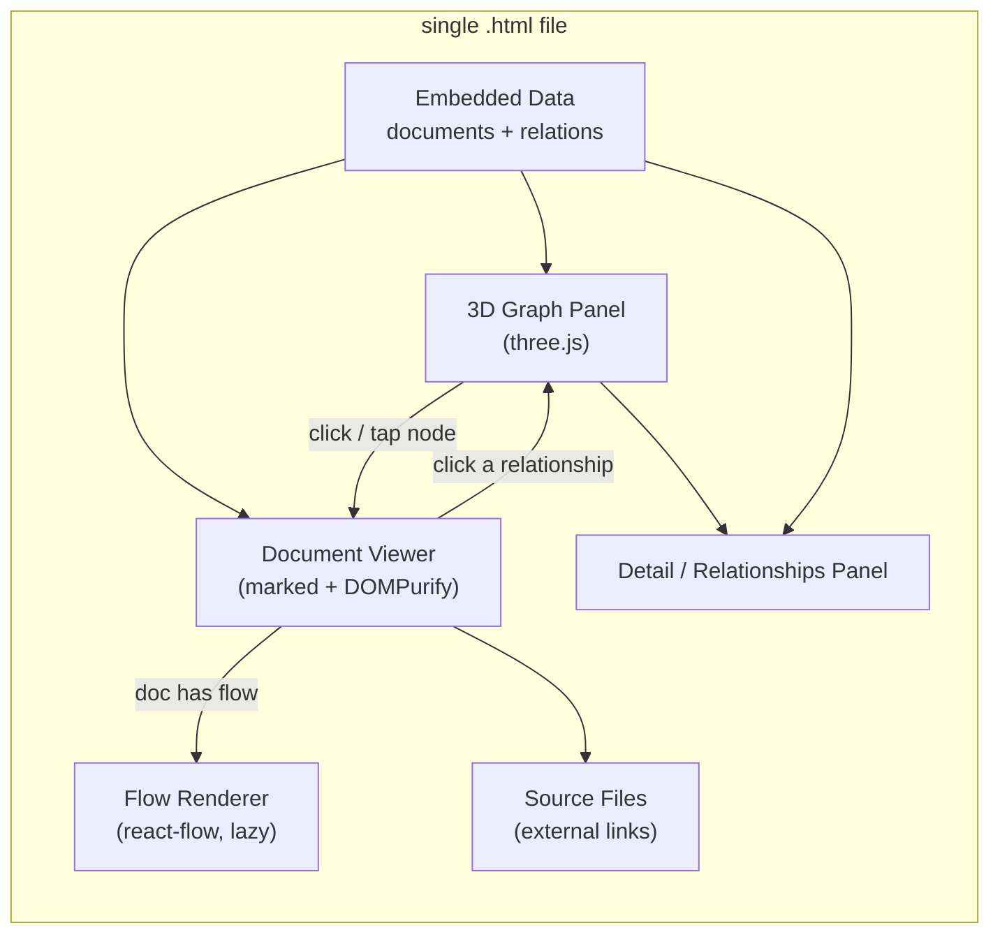

# Architecture Documentation System — Spec & Implementation Plan

> POC: a Knowledge Graph for architecture documentation, contained in a single `.html` file.
> POC file location: `D:\Work\github\archi-graph\index.html`

---

## 1. Problem Statement

Build a system to manage architecture documentation, where documents (BRD, SAD, HLD, LLD,
TSD, ADR, Design Patterns, diagrams) are organized into a **Knowledge Graph** that shows the
relationships between them. The first stage focuses on a **POC** contained in a single `.html`
file that runs directly in the browser with no build tooling.

The sample dataset models the **CorpDigi (Corporate Digital Banking)** platform, part of the Bank's
**System of Engagement**. The Bank landscape is split into 6 system groups (Engagement, Operation,
Integration, Security, Record, Data & Analytic). The graph shows CorpDigi's components along the
processing flow: **Frontend → API Gateway → BFF → Backend Services → Inbound Gateway → System of Record**.

---

## 2. Requirements

- Balanced **3-panel** layout with two-way sync: `3D graph (three.js)` | `document viewer` | `detail panel`.
- **three.js**: a 3D graph of the overall relationships between documents, used for navigation.
- **react-flow**: renders detailed flow diagrams inside a document (service flow, data flow…), lazy-mounted.
- Viewer renders **Markdown and HTML** (draw.io / docx are a later phase).
- **Embedded sample data** inside the file.
- Two edge kinds:
  - **Hierarchy** (`hierarchy`): structural chain BRD → SAD → HLD → LLD → TSD.
  - **Semantic** (`semantic`): "relates to", "supersedes", "depends on", "decided by ADR X"…
- **Two-way interaction**: click a node → open the document; interacting in the document → highlight the corresponding node.
- **Visual distinction**: node color by **system group**, icon by document type, line style by edge kind.
- **System groups**: not separate nodes — shown as **node color**, a **"System" row in the Details metadata**, the **Filter** panel, and the react-flow group boxes in the System Landscape.
- **Collapsible hierarchy**: opens collapsed to a high level; expand parent nodes on demand to reduce clutter.
- **Views**: default **3D** cluster; a **2D layered** mode arranges nodes by **tier** (processing-flow columns, left→right).
- **Edge focus**: initially only container-level edges are shown; selecting a node reveals only its adjacent edges.
- **Filter**: hide/show nodes by system group and/or document type.
- **Supporting features**: legend + node detail panel (metadata). *No text search needed.*

---

## 3. Technical Constraints

- **Single `.html` file** → all libraries loaded via **CDN**, no bundler.
- **Opens via `file://`**: uses **three.js r128 UMD** + OrbitControls + CSS2DRenderer (global `THREE`),
  no ES modules, so double-clicking the file works without a server.
- **react-flow** loaded lazily via `React + ReactDOM + react-flow` UMD from CDN, isolated, with a **fallback** if loading fails (e.g. offline).
- **Markdown rendering**: `marked` + `DOMPurify` (sanitized) via CDN.
- **Central state**: `selectedDocId` drives the two-way sync.

### 3.1. Data Model

```jsonc
// documents[]
{
  "id": "string",
  "type": "brd | sad | hld | lld | tsd | adr | dp | dia",
  "code": "string",         // identifier code shown on the node label, e.g. "ADR-001", "LLD-BMS-02"
  "shortTitle": "string",   // short description shown next to the code on the node label
  "group": "soe | soo | soi | sos | sor | soda",  // system group -> node color + bounding box
  "tier": "t0 | t1 | t2 | t3 | t3d | t4 | t5 | tx", // processing tier -> layered (2D) position
  "title": "string",
  "metadata": {
    "author": "string",
    "date": "YYYY-MM-DD",
    "status": "string",     // draft | accepted | superseded | stable ...
    "tags": ["string"]
  },
  "links": [                // optional — external source files
    { "provider": "sharepoint | confluence | github | gitlab | drawio | other",
      "name": "string", "url": "https://..." }
  ],
  "contentMarkdown": "string",
  "flow": {                 // optional — only when the document has a flow diagram
    "nodes": [ /* react-flow nodes */ ],
    "edges": [ /* react-flow edges */ ]
  }
}

// relations[]
{
  "source": "docId",
  "target": "docId",
  "kind": "hierarchy | semantic",
  "label": "string"
}
```

### 3.2. Document Types (code / color / icon)

| Code | Full name | Icon |
|------|-----------|------|
| BRD | Business Requirement Document | 📑 |
| SAD | Solution Architecture Document | 🏛️ |
| HLD | High-Level Design | 🗂️ |
| LLD | Low-Level Design | 🧩 |
| TSD | Technical Specification Document | 🗄️ |
| ADR | Architecture Decision Record | 📋 |
| DP  | Design Pattern | ♟️ |
| DIA | Diagram | 📐 |

Node labels use the format **identifier code + short title**, e.g. `[LLD-BMS-02] Payment & Transfer`.
The identifier code lets documents of the same type be distinguished.

### 3.3. System groups (node color) & Processing tiers (layered position)

| Group | Code | Meaning |
|-------|------|---------|
| soe | SoE | System of Engagement (CorpDigi lives here) |
| soo | SoO | System of Operation |
| soi | SoI | System of Integration (API gateways) |
| sos | SoS | System of Security (IAM, fraud) |
| sor | SoR | System of Record (Core Bank) |
| soda | SoDA | System of Data & Analytic (databases) |

| Tier | Column | Meaning |
|------|--------|---------|
| t0 | Frontend Apps | Web/Mobile MFE |
| t1 | API Gateway (Ext/Int) | edge gateways |
| t2 | BFF | Backend-for-Frontend |
| t3 | Backend Services | Business / Foundational / Channel |
| t3d | Databases | Oracle / Mongo / Redis / ODF (beside t3) |
| t4 | API Gateway (Inbound) | to core |
| t5 | System of Record | Core Bank |
| tx | Cross-cutting / Docs | BRD/SAD/HLD/ADR/DP/DIA + group nodes |

The two axes are independent: **tier** decides position (layered 2D), **group** decides node color.

---

## 4. Proposed Solution (UI architecture)



Three panels: left = 3D graph (three.js) + legend; center = document viewer (md/HTML) with an
embedded react-flow diagram when present and a "Source files" section of external links; right =
node detail panel (metadata + relationships). `selectedDocId` is the central state for two-way sync.

---

## 5. Implemented Features

### 5.1. Knowledge Graph (three.js)
- Each document is an icon sprite (a circular badge with the type icon). Node labels show the
  identifier code badge + short title, positioned in world space so they don't drift on 2D/3D toggle.
- Edges are drawn as 3D tubes with real thickness + a direction arrow (cone). `hierarchy` = thick blue
  solid; `semantic` = thinner purple dashed. Relationship labels appear on adjacent edges when a node is selected.
- **Node color = system group**; icon = document type; so clusters of the same group share a color.
- **Collapsible hierarchy**: composite business services (Account Management, Payment & Transfer) start
  **collapsed** and show a ▸/▾ caret; clicking a parent expands/collapses its children (and opens its
  document). A **Collapse / Expand** button toggles all composites at once. The layout is
  **recomputed for the visible subset** so columns/clusters stay tight.
- **Edge visibility** stays uncluttered: with nothing selected, only edges among the currently visible
  nodes are shown (so the initial collapsed view shows just container-level relationships). Selecting a
  node shows **only its adjacent edges**; the rest are hidden until you deselect or expand deeper.
- OrbitControls for rotate/zoom/pan. Layouts: **3D spring/repulsion cluster (default view)**; 2D = layered by tier.

### 5.2. Interaction
- **Selection** works for mouse, touch and pen via a single Pointer Events path with tap-vs-drag
  detection (a short, low-movement press selects; a drag rotates/pans the graph).
- **Two-way sync**: clicking a node opens the document + updates the detail panel and highlights the
  node and its adjacent edges; clicking a relationship in the detail panel navigates to that node.

### 5.3. Document Viewer
- Renders sanitized Markdown (`marked` + `DOMPurify`). The viewer fills its panel and scrolls internally
  so long documents and the flow diagram at the bottom are always reachable.
- **Source files** section: links to the original document on external systems (mock URLs) —
  **SharePoint, Confluence, GitHub, GitLab, draw.io** — each with a provider icon/color; only http(s)
  URLs are allowed and they open in a new tab (`rel="noopener"`). The Code document (TSD-01) links to
  its **GitLab source repository** and the `Order.java` file.
- **react-flow** flow diagrams are lazy-loaded only when the open document has a `flow`, with a graceful
  fallback if the library can't be loaded.

### 5.4. Detail / Relationships Panel
- Shows type, identifier code + short title, metadata (author/date/status/type/**system group**/**tier**), tags.
- Framework documents (BRD/SAD/HLD) are no longer graph nodes; the C4 level is conveyed by the document
  **type** and the **tier** metadata row, keeping the graph focused on real components.
- **Relationships** are grouped by kind — *Hierarchy* and *Semantic* — each item showing the related
  document's code + short title, direction (→ / ←) and label; empty groups are hidden.

### 5.5. View Controls
- **2D / 3D toggle** (default **3D**): 3D = free-orbit perspective clustered by group; 2D = **layered view**
  with nodes in tier columns (Frontend → … → System of Record, left→right) and per-column tier headers, rotation locked.
- **Light / Dark background toggle** for the graph (scene + overlays), independent of the document/detail panels.
- **Filter panel**: a `☰ Filter` button opens a panel with checkboxes for the 6 system groups and 8 document
  types (plus All / None). Hiding a group/type hides its nodes, incident edges, and (for groups) its bounding box.
- The graph starts full-screen (side panels hidden, set directly in the HTML so it holds from first paint);
  panels reveal on node selection and collapse via the ✕ button or the `Esc` key.
- **View switch** in the header: *Knowledge Graph* ↔ *Design Patterns*.

### 5.6. Design Patterns Page
- A dedicated full-screen page (toggled from the header) with a pattern list on the left and, on the
  right, a **concept diagram rendered with react-flow** plus text (summary, when to use, pros, cons).
- Catalog of 8 patterns: **MFE, BFF, CQRS, SAGA, Outbox, API Gateway, Event Sourcing, Circuit Breaker**
  (`designPatterns[]`, each with its own `flow`).
- Five of them (MFE, BFF, CQRS, SAGA, Outbox) are also linked into the knowledge graph as **DP nodes**
  with the same flow, related to the components that apply them.
- A **System Landscape map** (react-flow) shows CorpDigi's end-to-end flow
  (Frontend → API Gateway → BFF → Backend Services → Databases → Inbound Gateway → System of Record).
  Its nodes carry a `docId`, so **clicking a node jumps to the related document** in the graph view.
  Each pattern that has a graph node also shows an **"Open in graph"** button. Clickable flow nodes use `onNodeClick`.

---

## 6. Sample Data

- **~60 documents** (~45 components + ADRs/diagram + 5 pattern nodes; the 6 system groups **and** the
  BRD/SAD/HLD framework docs are metadata, not nodes), **~45 relations** (`hierarchy` for Account/Payment
  composites; `semantic` for the processing flow and dependencies).
- Domain: **CorpDigi (Corporate Digital Banking)** — Frontend (Web Customer/BackOffice Angular MFE, Mobile Flutter),
  BFFs (Java 25 / Spring Boot), Business microservices (Account Management, Payment & Transfer + sub-services),
  Foundational microservices (onboarding, entitlement, limits, FX, alerts, fraud & security, …), Channel Support
  (IAM Keycloak/ForgeRock, workflow, format mapper, notification, batch, doc/QR generation), Databases
  (Oracle, MongoDB, Redis, ODF), API Gateways (External/Internal/Inbound), and the Core Bank (System of Record).
- Structural chain BRD → SAD (Context + 6 groups) → HLD (Container + tier flow) → LLD (each component); ADRs
  (MFE, Java 25, IAM, polyglot persistence, gateways) + an OpenShift deployment diagram.
- A separate catalog of 8 design patterns powers the Design Patterns page.

---

## 7. Future Directions (beyond the POC)

- Move data to JSON / a backend.
- Render draw.io (`.drawio` / `.svg`) and `.docx` (mammoth.js) natively.
- Add text search (a group/type filter already exists).
- Move to a real build (Vite + React) instead of CDN UMD.
- Document editing / persistence.

---

## 8. Verification Notes

Each change is verified by running the file in headless Edge over `file://`: checking rendered DOM,
node labels, source links, relationship grouping, 2D/3D toggle, background toggle, touch selection,
and the absence of console errors. Static syntax of the inline scripts is checked with `node --check`.
Rendered WebGL pixels are best confirmed visually in a real browser.
