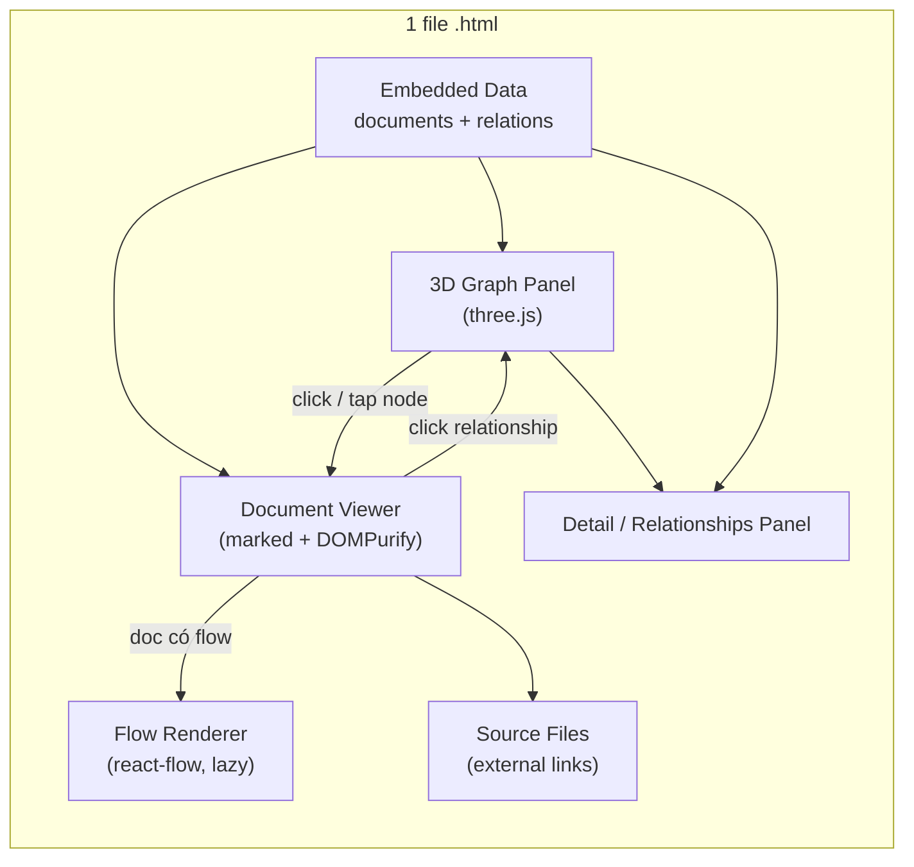

# Hệ thống Quản lý Tài liệu Kiến trúc — Spec & Kế hoạch Triển khai

> POC: Knowledge Graph cho tài liệu kiến trúc, gói gọn trong một file `.html` duy nhất.
> Vị trí file POC: `D:\Work\github\archi-graph\index.html`
> Bản tiếng Anh: `SPEC.en.md`

---

## 1. Bối cảnh & Vấn đề

Xây dựng hệ thống quản lý tài liệu kiến trúc, trong đó các tài liệu (BRD, SAD, HLD, LLD,
TSD, ADR, Design Pattern, diagram) được tổ chức thành một **Knowledge Graph** thể hiện
mối liên hệ giữa chúng. Giai đoạn đầu tập trung vào một bản **POC** gói gọn trong một file
`.html` duy nhất, chạy trực tiếp trên trình duyệt mà không cần build tool.

Bộ dữ liệu mẫu mô hình hoá nền tảng **CorpDigi (Corporate Digital Banking)**, thuộc **System of
Engagement** của Bank. Bối cảnh Bank chia thành 6 nhóm hệ thống (Engagement, Operation, Integration,
Security, Record, Data & Analytic). Đồ thị thể hiện các component của CorpDigi theo luồng xử lý:
**Frontend → API Gateway → BFF → Backend Services → Inbound Gateway → System of Record**.

---

## 2. Yêu cầu

- Bố cục cân bằng **3 vùng**, đồng bộ hai chiều: `3D graph (three.js)` | `document viewer` | `detail panel`.
- **three.js**: đồ thị 3D thể hiện mối liên kết tổng thể giữa các tài liệu, dùng để điều hướng.
- **react-flow**: render sơ đồ flow chi tiết bên trong tài liệu (service flow, data flow…), lazy mount.
- Viewer render **Markdown và HTML** (draw.io / docx để giai đoạn sau).
- **Dữ liệu mẫu nhúng sẵn** trong file.
- Hai loại edge:
  - **Phân cấp** (`hierarchy`): chuỗi cấu trúc BRD → SAD → HLD → LLD → TSD.
  - **Ngữ nghĩa** (`semantic`): "liên quan đến", "thay thế", "phụ thuộc vào", "được quyết định bởi ADR X"…
- **Tương tác hai chiều**: click node → mở tài liệu; thao tác trong tài liệu → highlight node tương ứng.
- **Phân biệt hình ảnh**: màu node theo **nhóm hệ thống**, icon theo loại tài liệu, kiểu đường theo loại edge.
- **Nhóm hệ thống**: không còn là node riêng — thể hiện bằng **màu node**, dòng **"System" trong Metadata** ở panel Details, **Filter**, và **group box** trong sơ đồ System Landscape.
- **Phân cấp mở/gập**: đồ thị mở ở trạng thái gập tới cấp cao; bung node cha khi cần để đỡ rối.
- **Chế độ xem**: mặc định **3D** gom theo nhóm; có chế độ **2D layered** xếp node theo **tier** (cột theo luồng xử lý, trái→phải).
- **Tập trung edge**: ban đầu chỉ hiện edge ở mức Container; chọn một node sẽ chỉ hiện edge liền kề của node đó.
- **Filter**: ẩn/hiện node theo nhóm hệ thống và/hoặc loại tài liệu.
- **Tính năng phụ**: legend + panel chi tiết node (metadata). *Không cần text search.*

---

## 3. Ràng buộc kỹ thuật

- **Một file `.html` duy nhất** → mọi thư viện load qua **CDN**, không dùng bundler.
- **Mở được bằng `file://`**: dùng **three.js r128 UMD** + OrbitControls + CSS2DRenderer (global `THREE`),
  bỏ ES module, nên double-click mở file trực tiếp không cần server.
- **react-flow** nạp lazy qua `React + ReactDOM + react-flow` UMD từ CDN, cô lập khu vực riêng, có **fallback** nếu tải lỗi (ví dụ offline).
- **Render markdown**: `marked` + `DOMPurify` (đã sanitize) qua CDN.
- **State trung tâm**: `selectedDocId` điều phối đồng bộ hai chiều.

### 3.1. Mô hình dữ liệu

```jsonc
// documents[]
{
  "id": "string",
  "type": "brd | sad | hld | lld | tsd | adr | dp | dia",
  "code": "string",         // mã định danh hiển thị trên node label, ví dụ "ADR-001", "LLD-BMS-02"
  "shortTitle": "string",   // mô tả ngắn hiển thị cạnh mã trên node label
  "group": "soe | soo | soi | sos | sor | soda",  // nhóm hệ thống -> màu node + bounding box
  "tier": "t0 | t1 | t2 | t3 | t3d | t4 | t5 | tx", // tier xử lý -> vị trí layered (2D)
  "title": "string",
  "metadata": {
    "author": "string",
    "date": "YYYY-MM-DD",
    "status": "string",     // draft | accepted | superseded | stable ...
    "tags": ["string"]
  },
  "links": [                // tùy chọn — link tới file nguồn bên ngoài
    { "provider": "sharepoint | confluence | github | gitlab | drawio | other",
      "name": "string", "url": "https://..." }
  ],
  "contentMarkdown": "string",
  "flow": {                 // tùy chọn — chỉ khi tài liệu có sơ đồ flow
    "nodes": [ /* react-flow nodes */ ],
    "edges": [ /* react-flow edges */ ]
  }
}

// relations[]
{
  "source": "docId",
  "target": "docId",
  "kind": "hierarchy | semantic",
  "label": "string"
}
```

### 3.2. Loại tài liệu (mã / màu / icon)

| Mã | Tên đầy đủ | Icon |
|------|-----------|------|
| BRD | Business Requirement Document | 📑 |
| SAD | Solution Architecture Document | 🏛️ |
| HLD | High-Level Design | 🗂️ |
| LLD | Low-Level Design | 🧩 |
| TSD | Technical Specification Document | 🗄️ |
| ADR | Architecture Decision Record | 📋 |
| DP  | Design Pattern | ♟️ |
| DIA | Diagram | 📐 |

Node label theo format **mã định danh + short-title**, ví dụ `[LLD-BMS-02] Payment & Transfer`.
Mã định danh giúp phân biệt các tài liệu **cùng loại**.

### 3.3. Nhóm hệ thống (màu node) & Tier xử lý (vị trí layered)

| Nhóm | Mã | Ý nghĩa |
|-------|------|---------|
| soe | SoE | System of Engagement (CorpDigi thuộc nhóm này) |
| soo | SoO | System of Operation |
| soi | SoI | System of Integration (API gateways) |
| sos | SoS | System of Security (IAM, fraud) |
| sor | SoR | System of Record (Core Bank) |
| soda | SoDA | System of Data & Analytic (databases) |

| Tier | Cột | Ý nghĩa |
|------|--------|---------|
| t0 | Frontend Apps | Web/Mobile MFE |
| t1 | API Gateway (Ext/Int) | gateway biên |
| t2 | BFF | Backend-for-Frontend |
| t3 | Backend Services | Business / Foundational / Channel |
| t3d | Databases | Oracle / Mongo / Redis / ODF (cạnh t3) |
| t4 | API Gateway (Inbound) | vào core |
| t5 | System of Record | Core Bank |
| tx | Cross-cutting / Docs | BRD/SAD/HLD/ADR/DP/DIA + node nhóm |

Hai trục độc lập: **tier** quyết định vị trí (layered 2D), **nhóm** quyết định màu node.

---

## 4. Giải pháp đề xuất (kiến trúc UI)



Ba vùng: trái = 3D graph (three.js) + legend; giữa = document viewer (md/HTML) có nhúng
react-flow khi cần và section "Source files" chứa link ngoài; phải = panel chi tiết node
(metadata + relationships). `selectedDocId` là state trung tâm cho đồng bộ hai chiều.

---

## 5. Tính năng đã hiện thực

### 5.1. Knowledge Graph (three.js)
- Mỗi tài liệu là một sprite icon (badge tròn có icon theo loại). Node label hiển thị badge mã định danh
  + short-title, đặt trong không gian thế giới nên không bị lệch khi toggle 2D/3D.
- Cạnh vẽ bằng ống 3D có độ dày thật + mũi tên chỉ hướng (cone). `hierarchy` = ống dày, xanh, nét liền;
  `semantic` = mảnh, tím, nét đứt. Nhãn quan hệ hiện trên các cạnh liền kề khi node được chọn.
- **Màu node = nhóm hệ thống**; icon = loại tài liệu; nên các cụm cùng nhóm chung một màu.
- **Phân cấp mở/gập**: các service nghiệp vụ tổng hợp (Account Management, Payment & Transfer) mặc định
  **gập** và có mũi ▸/▾; click node cha để bung/gập con (đồng thời mở tài liệu). Nút **Collapse / Expand**
  gập/bung tất cả cùng lúc. Layout được **tính lại theo tập node đang hiển thị** để cột/cụm luôn gọn.
- **Hiển thị edge** giữ gọn: khi chưa chọn gì, chỉ hiện edge giữa các node đang hiển thị (nên ở trạng thái
  gập ban đầu chỉ thấy quan hệ ở mức Container). Chọn một node sẽ **chỉ hiện edge liền kề** node đó; phần
  còn lại được ẩn cho tới khi bỏ chọn hoặc bung sâu hơn.
- OrbitControls cho xoay/zoom/pan. Layout: **3D cụm spring/repulsion (mặc định)**; 2D = layered theo tier.

### 5.2. Tương tác
- **Chọn node** hoạt động cho chuột, cảm ứng và bút qua một luồng Pointer Events thống nhất, có phân biệt
  tap và drag (nhấn nhanh, ít di chuyển → chọn; kéo → xoay/pan graph).
- **Đồng bộ hai chiều**: click node mở tài liệu + cập nhật panel chi tiết và highlight node cùng các cạnh
  liền kề; click một quan hệ trong panel chi tiết điều hướng tới node đó.

### 5.3. Document Viewer
- Render Markdown đã sanitize (`marked` + `DOMPurify`). Viewer lấp đầy panel và cuộn nội bộ để tài liệu dài
  cùng sơ đồ flow ở cuối luôn xem được.
- Section **Source files**: link tới bản gốc trên hệ ngoài (mock URL) — **SharePoint, Confluence, GitHub,
  GitLab, draw.io** — mỗi link có icon/màu theo provider; chỉ chấp nhận URL http(s), mở ở tab mới
  (`rel="noopener"`). Tài liệu Code (TSD-01) link tới **source repo trên GitLab** và file `Order.java`.
- Sơ đồ **react-flow** chỉ nạp lazy khi tài liệu đang mở có `flow`, có fallback nhẹ nếu tải lỗi.

### 5.4. Panel Chi tiết / Relationships
- Hiển thị loại, mã định danh + short-title, metadata (author/date/status/type/**nhóm hệ thống**/**tier**), tags.
- Tài liệu khung (BRD/SAD/HLD) không còn là node đồ thị; cấp C4 được thể hiện qua **loại tài liệu** và
  dòng **tier** trong metadata, giúp đồ thị tập trung vào các component thật.
- **Relationships** nhóm theo loại — *Hierarchy* và *Semantic* — mỗi mục hiển thị mã + short-title của tài
  liệu liên quan, chiều quan hệ (→ / ←) và nhãn; nhóm rỗng được ẩn.

### 5.5. Điều khiển hiển thị
- **Toggle 2D / 3D** (mặc định **3D**): 3D = phối cảnh xoay tự do, gom theo nhóm; 2D = **layered view** xếp node
  theo cột tier (Frontend → … → System of Record, trái→phải) kèm nhãn tier mỗi cột, khoá xoay.
- **Toggle nền Light / Dark** cho graph (scene + overlay), độc lập với panel document/detail.
- **Filter panel**: nút `☰ Filter` mở panel với checkbox cho 6 nhóm hệ thống và 8 loại tài liệu (kèm All / None).
  Ẩn một nhóm/loại sẽ ẩn node, cạnh liền kề, và (với nhóm) cả bounding box.
- Graph khởi động ở chế độ toàn màn hình (ẩn panel bên, đặt trực tiếp trong HTML nên đúng ngay từ lần paint
  đầu tiên); panel hiện ra khi chọn node và thu gọn bằng nút ✕ hoặc phím `Esc`.
- **Chuyển view** trên header: *Knowledge Graph* ↔ *Design Patterns*.

### 5.6. Trang Design Patterns
- Một trang riêng toàn màn hình (bật từ header) với danh sách pattern bên trái, bên phải là **sơ đồ khái
  niệm render bằng react-flow** kèm mô tả (tóm tắt, khi nào dùng, ưu điểm, nhược điểm).
- Danh mục 8 pattern: **MFE, BFF, CQRS, SAGA, Outbox, API Gateway, Event Sourcing, Circuit Breaker**
  (`designPatterns[]`, mỗi pattern có `flow` riêng).
- Năm pattern (MFE, BFF, CQRS, SAGA, Outbox) cũng được đưa vào knowledge graph dưới dạng **node DP** với
  cùng sơ đồ, liên kết tới các component áp dụng chúng.
- Có **sơ đồ System Landscape** bằng react-flow cho thấy luồng end-to-end của CorpDigi
  (Frontend → API Gateway → BFF → Backend Services → Databases → Inbound Gateway → System of Record).
  Các node của sơ đồ mang `docId` nên **click vào node sẽ nhảy tới tài liệu liên quan** trong graph.
  Mỗi pattern có node trong graph còn có nút **"Open in graph"**. Node flow clickable dùng `onNodeClick`.

---

## 6. Dữ liệu mẫu

- **~60 tài liệu** (~45 component + ADR/diagram + 5 node pattern; 6 nhóm hệ thống **và** tài liệu khung
  BRD/SAD/HLD là metadata, không phải node), **~45 quan hệ** (`hierarchy` cho Account/Payment; `semantic`
  cho luồng xử lý và phụ thuộc).
- Miền: **CorpDigi (Corporate Digital Banking)** — Frontend (Web Customer/BackOffice Angular MFE, Mobile Flutter),
  BFF (Java 25 / Spring Boot), Business microservices (Account Management, Payment & Transfer + service con),
  Foundational microservices (onboarding, entitlement, limit, FX, alert, fraud & security, …), Channel Support
  (IAM Keycloak/ForgeRock, workflow, format mapper, notification, batch, doc/QR generation), Databases
  (Oracle, MongoDB, Redis, ODF), API Gateway (External/Internal/Inbound), và Core Bank (System of Record).
- Chuỗi cấu trúc BRD → SAD (Context + 6 nhóm) → HLD (Container + luồng tier) → LLD (từng component); các ADR
  (MFE, Java 25, IAM, polyglot persistence, gateways) + một deployment diagram trên OpenShift.
- Một danh mục riêng gồm 8 design pattern cấp dữ liệu cho trang Design Patterns.

---

## 7. Định hướng giai đoạn sau (ngoài phạm vi POC)

- Tách dữ liệu ra JSON / backend.
- Render draw.io (`.drawio` / `.svg`) và `.docx` (mammoth.js) trực tiếp.
- Thêm text search (đã có filter theo nhóm/loại).
- Chuyển sang bản build thực thụ (Vite + React) thay cho CDN UMD.
- Cơ chế chỉnh sửa / lưu tài liệu.

---

## 8. Ghi chú kiểm thử

Mỗi thay đổi được verify bằng cách chạy file trong Edge headless qua `file://`: kiểm tra DOM đã render,
node label, source links, cách nhóm relationships, toggle 2D/3D, toggle nền, chọn node bằng cảm ứng, và
không có lỗi console. Cú pháp tĩnh của các khối script được kiểm bằng `node --check`. Phần WebGL render
pixel nên xác nhận trực quan trên trình duyệt thật.
